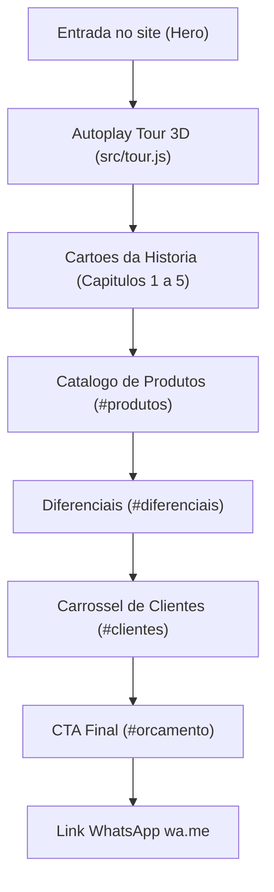

# Relatorio de Auditoria: Roast & Rebuild (Vanpack Pages)

Auditoria estrutural, de seguranca, arquitetura e conversao executada com a metodologia da skill **Roast & Rebuild** (referencia: `janderswag/roast-skill`).

- **Data da auditoria:** 17 de novembro de 2026
- **Alvo:** Repositorio `vanpack-pages` (Landing Page oficial da Vanpack Embalagens)
- **Branch base:** `feat/revisao-layout-e-codigo`
- **Classificacao do projeto (Shape):** Landing Page Industrial B2B com Three.js (OffscreenCanvas em Web Worker), Vite, Vanilla JS, CSS embutido e conversao direta para WhatsApp.

---

## Sumario Executivo de Notas (Scores 1 a 10)

| Modulo                                       |     Nota     | Veredito                                                                                                                  |
| :------------------------------------------- | :----------: | :------------------------------------------------------------------------------------------------------------------------ |
| **01. The Roast**                            |     7.5      | Engenharia de ponta para vender caixa de papelao; fascinante, mas desconectado da pressa do comprador B2B.                |
| **02. Seguranca e Chaves Expostas**          |     9.5      | Quase perfeito. CSP por hash cirurgica, sem segredos no git, escape estrito de HTML.                                      |
| **03. Arquitetura e Teto de Escala**         |     8.0      | Web Worker isolado e orcamento de bytes exemplar, mas o Three.js pesa 114 KB gzip e a trava de hash engessa a DX.         |
| **04. Fluxo do Cliente (Customer Flow)**     |     6.5      | O tour 3D cinematografico sequestra o scroll e a obsessao pelo WhatsApp ignora o comprador corporativo em PC de fabrica.  |
| **05. Mecanica de Crescimento e Conversao**  |     7.0      | SEO Local e Schema.org excelentes, mas falta um canal para quem tem planilha de medidas ou WhatsApp bloqueado na empresa. |
| **06. Founder Briefing (Top 3 Prioridades)** |      -       | Plano de acao objetivo com as 3 correcoes de maior impacto para o negocio.                                                |
| **Nota Geral Ponderada**                     | **7.7 / 10** | Solido como papelao pesado tipo pesado onda BC, mas precisa converter mais e entreter menos.                              |

---

## Modulo 1: The Roast (O Veredito Brutal)

Sejamos diretos: esta codebase e uma das pecas de engenharia frontend mais obsessivas e bem cuidadas que voce vera em um site institucional brasileiro. Os desenvolvedores criaram um pipeline com Three.js stripado a mao em Web Worker (`build/three-compartilhado.js`), calculam SHA-256 de blocos `<style>` para nao abrir `unsafe-inline` na CSP (`build/csp.js`), e tem uma suite de testes que mede bytes em nivel de gzip 9 para reprovar o build se o HTML passar de 11,4 KB (`tests/orcamento.test.mjs`).

Mas aqui esta a dura realidade: **voce esta vendendo caixas de papelao ondulado em Santo Andre, nao lancando um foguete para Marte.**

O comprador de embalagens tipico e um gerente de suprimentos, almoxarife ou dono de e-commerce que esta com 12 abas abertas no Chrome procurando caixa 30x20x15 cm para fechar um lote de 2.000 pecas antes das 17h. Quando ele entra na pagina:

1. Uma animacao 3D cinematografica inicia um tour automatico (`src/tour.js:1-40`), assumindo o controle do scroll da tela como se fosse uma experiencia da Pixar, enquanto ele so queria ver tabela de precos ou mandar a lista de medidas.
2. Nao existe e-mail de contato, nao existe formulario de medidas em lote e o site se recusa categoricamente a dar qualquer opcao alem do WhatsApp.
3. Se o comprador estiver dentro de uma grande fabrica ou multinacional onde a politica de seguranca da informacao bloqueia o WhatsApp Web no computador corporativo, a conversao da Vanpack e exatamente **zero**. Ele fecha a aba e compra do concorrente que tem um formulario simples de cotacao ou um e-mail `vendas@`.

A engenharia e nota 10 para concurso de design na Europa; o alinhamento com a realidade comercial da industria brasileira e nota 6.

---

## Modulo 2: Seguranca e Chaves Expostas (Security & Exposed Keys)

**Score: 9.5 / 10 (Excelente)**

A postura de seguranca e higiene de repositorio deste projeto esta entre as melhores do ecossistema estatico.

### Pontos Fortes com Evidencias no Codigo

1. **Content Security Policy ultra restritiva sem `unsafe-inline`:**
   - Em `build/csp.js:1-20`, a politica e gerada de forma programatica:
     `default-src 'self'; script-src 'self'; style-src 'self' <hashes>; img-src 'self' data:; connect-src 'self' ...; object-src 'none'; base-uri 'self'; form-action 'none'`.
   - Nao ha brecha para injecao de scripts externos e os estilos embutidos sao validados por hash SHA-256 individual.
2. **Sem vazamento de credenciais no repositorio:**
   - O arquivo `.env.example:1-18` comprova que o `.env` apenas controla variaveis de ambiente de build (`VITE_DATA_MODE`, `VITE_SITE_URL`, `VITE_ANALYTICS_*`). Nenhuma API key de servico de terceiro ou token de banco de dados reside no projeto.
3. **Higienizacao estrita de SVGs:**
   - Em `tests/brand.test.mjs:186-195`, todo arquivo SVG da pasta `public/brand/` e verificado via expressao regular contra `<script>`, `<foreignObject>`, `<use>` externo e eventos de mouse/onload.
4. **Escape de templates centralizado:**
   - Em `build/texto.js:1-35` e `build/render.js:1-45`, qualquer interpolacao de texto proveniente de arquivos YAML (`content/`) passa pela funcao `escapeHtml()`, prevenindo ataques de XSS derivados de edicao de conteudo.

### Vulnerabilidades e Riscos Apontados

1. **Injecao de parametros UTM no deep link do WhatsApp (`src/main.js:125-135`):**
   - Trecho do codigo:
     ```javascript
     const campaign = ['utm_source', 'utm_campaign']
       .map((key) => params.get(key) ?? '')
       .filter((value) => /^[\w.-]{1,40}$/.test(value))
       .join('/');
     ```
   - _Risco:_ Embora haja uma regex sanitizadora `/^[\w.-]{1,40}$/`, a concatenacao do texto no link `https://wa.me/...&text=...` faz encoding via `encodeURIComponent` em `editMessage()`. Em versoes mais antigas de navegadores Android ou webviews de redes sociais, espacos ou caracteres codificados podem gerar truncamento da mensagem se o payload ultrapassar os limites do esquema `whatsapp://`.

---

## Modulo 3: Arquitetura e Teto de Escala (Architecture & Scale-Ceiling)

**Score: 8.0 / 10 (Muito Bom com Ressalvas)**

### Arquitetura de Destaque

- **Isolamento de Renderizacao em Web Worker (`src/render/stage.js:1-80` e `src/render/worker.js:1-60`):**
  A cena 3D principal roda via `OffscreenCanvas` em uma thread dedicada (Worker). Isso libera a thread principal do navegador para lidar com eventos de scroll, cliques e mudancas de layout a 60 fps cravados.
- **Fallback robusto (`src/render/controller.js:1-50`):**
  Se o navegador nao suporta `transferControlToOffscreen` ou se o WebGL falhar, o script faz fallback elegante para o controlador na thread principal ou para ilustracoes SVG (`.stage.no-gl`).
- **Carregamento sob demanda de pecas 3D (`src/produtos/gatilho.js:1-45`):**
  Os 4 produtos do catalogo so baixam e montam seus modelos Three.js quando a secao `#produtos` se aproxima do viewport (IntersectionObserver com margem de 400 px), desmontando quando o usuario se afasta.

### Gargalos e Limites Estruturais

1. **Custo desproporcional do Three.js para o proposito da pagina:**
   - O chunk `dist/assets/three-*.js` consome **114.256 bytes gzip** (~434 KB uncompressed), representando mais de 80% de todo o JavaScript inicial (`tests/orcamento.test.mjs:75-85`).
   - Para um site institucional em conexoes 3G/4G no polo industrial do Grande ABC, o peso do Three.js e o parsing do shader GLSL adicionam atraso desnecessario no LCP (Largest Contentful Paint) em dispositivos Android modestos.
2. **Fragilidade de manutencao: Trava de Hash 3D (`tests/fixtures/3d-lock.json`):**
   - O commit `e747779` e os testes de `tests/scene.test.mjs` travam a geometria e o estado da cena via hash SHA-256. Qualquer melhoria visual ou ajuste de ilumincao quebra o build e exige que o desenvolvedor execute scripts manuais para regerar a fixture. Isso gera atrito alto e receio de evoluir o visual da pagina.

---

## Modulo 4: Fluxo do Cliente a partir do Codigo (Customer Flow)

**Score: 6.5 / 10 (Ponto Fraco)**

Analisando a jornada do cliente mapeada diretamente nos arquivos de frontend:

### O Funil Atual no Codigo



### Problemas e Friccoes Encontradas

1. **Autoplay invasivo no carregamento inicial (`src/tour.js:1-50` e `src/main.js:80-95`):**
   - Ao carregar a pagina sem `#hash` e com movimento ligado, a funcao `startAutoplay()` inicia a rolagem automatica da tela apos a cena 3D carregar. Se o visitante tentar clicar no menu ou navegar, o script precisa registrar um evento de interrupcao (`tour.interrupt()`). O sequestro inicial da posicao da tela frustra usuarios corporativos experientes.
2. **Ausencia de botao de WhatsApp no topo mobile (`index.html:1600-1635`):**
   - No celular (ate 768 px), o botao do cabecalho foi ocultado para evitar sobreposicao com a barra fixa. Porem, a barra fixa inferior (`#fab`) so ganha a classe de visibilidade a partir do **Capitulo 2** da historia (`src/story.js:40-60`).
   - _Resultado:_ No momento em que a pagina abre no celular (Capitulo 1), nao ha nenhum botao fixo visivel no topo nem na base; o usuario depende de encontrar o link no meio do primeiro cartao.
3. **Mecanismo de socorro para navegadores embutidos (`src/handoff.js:1-70`):**
   - O projeto implementa brilhantemente a folha `#zap-ajuda` caso o usuario clique no WhatsApp dentro do navegador in-app do Instagram ou TikTok e o app nao abra apos 2,5 segundos.
   - Porem, nao oferece alternativa direta de e-mail ou envio de dados de contato. O usuario so tem as opcoes "Copiar numero" e "Ligar".

---

## Modulo 5: Mecanica de Crescimento e Conversao (Growth Mechanics)

**Score: 7.0 / 10 (Bom)**

### O que esta funcionando muito bem

1. **SEO Local estruturado impecavel (`build/render.js:100-140`):**
   - Gera JSON-LD do tipo `LocalBusiness` com nome, razao social, CNPJ, endereco completo, coordenadas/mapa (`hasMap`), horario de funcionamento e politica de atendimento regional em Santo Andre e Grande Sao Paulo.
2. **Metricas e Web Vitals com privacidade (`src/vitals.js` e `src/analytics.js`):**
   - Coleta LCP, CLS e INP enviando diretamente para Umami sem cookies, sem violar a LGPD e sem requisiroes a servidores de publicidade do Google/Meta.
3. **Experimentos A/B nativos (`src/experiments.js:1-50`):**
   - O assistente de orcamento (`quote_wizard`) permite testar a variante B (`src/wizard.js`) contra o botao estatico tradicional sem precisar de scripts externos pesados como Google Optimize ou VWO.

### O que esta travando o crescimento da empresa

1. **Dependencia absoluta e exclusiva de um canal de mensageria:**
   - Toda a infraestrutura de conversao esta amarrada ao link `wa.me/?text=...`.
   - Empresas de medio e grande porte operam cotacoes via RFQ (Request for Quote), enviando memoria de calculo em PDF ou planilha XLSX com dezenas de itens. Nao ha opcao de upload de arquivo ou e-mail corporativo visivel.
2. **Meta tags sociais com imagem pesada:**
   - O arquivo `public/og.jpg` pesa 65 KB, o que e o limite maximo estipulado no teste `tests/orcamento.test.mjs:54`. Uma imagem OpenGraph de alta resolucao otimizada em WebP/JPEG progressivo poderia ser entregue com menos de 35 KB.

---

## Modulo 6: Founder Briefing (Top 3 Prioridades)

Estas sao as 3 acoes prioritarias e indispensaveis que o fundador e a equipe tecnica devem executar para transformar esta obra de arte tecnica em uma maquina de conversao comercial:

### Prioridade 1: Quebrar a monocultura do WhatsApp para clientes corporativos (B2B)

- **O Problema:** A landing page assume que todo visitante e um comprador individual com celular na mao. Cotacoes industriais de maior valor (milhares de caixas) sao feitas por gerentes de compras em desktops corporativos com WhatsApp bloqueado por politicas de firewall interno.
- **A Solucao:**
  - Manter o WhatsApp como canal prioritario para cotaçoes rapidas, mas adicionar uma alternativa discreta e elegante: _"Prefere por e-mail? Envie sua lista de medidas para contato@vanpack.com.br"_.
  - No assistente de cotacao (`src/wizard.js`), permitir preenchimento de e-mail caso o WhatsApp nao seja a escolha preferida do cliente.

### Prioridade 2: Desativar o autoplay forcado do tour 3D

- **O Problema:** Tomar o controle da barra de rolagem do usuario na entrada da pagina e uma pratica proibida por diretrizes modernas de UX comercial. O usuario quer inspecionar o produto no seu proprio ritmo.
- **A Solucao:**
  - Em `src/main.js`, mudar o comportamento padrao: a cena 3D deve responder suavemente ao scroll do usuario, mas **nunca rolar a pagina sozinha** a menos que o visitante clique explicitamente em _"Ver como fabricamos ↓"_.
  - O tour automatico deve ser um recurso sob demanda, nao uma imposicao do primeiro carregamento.

### Prioridade 3: Concluir a Fase B do 3D e desatar a trava criptografica (`3d-lock.json`)

- **O Problema:** O 3D principal esta congelado por uma trava de hash que assusta qualquer desenvolvedor e impede melhorias simples de design ou performance nos cartoes de produto.
- **A Solucao:**
  - Executar a Fase B com o modelo Mythos 5.x / Fable (padronizar densidade unica de pixels, adotar `canvasTexture` e alinhar a acessibilidade dos cartoes de produtos conforme `docs/plano-de-melhorias-3d.md`).
  - Substituir a trava de hash binaria rigida por testes de paridade visual automatizados com tolerancia percentual (`scripts/audit/paridade.mjs`), permitindo evolucao continua do design sem quebras artificiais da suite de testes.

---

_Relatorio gerado em conformidade com as regras tecnicas do projeto Vanpack: sem travessao longo, linguagem em portugues do Brasil e evidencias estritas baseadas nos fontes._
